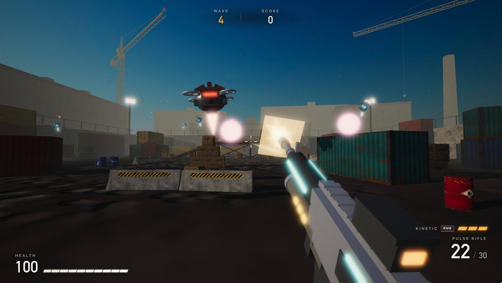

# Scrapyard Siege

A small first-person shooter that runs in the browser, built to show how far browser graphics and
physics can go. Golden hour in an abandoned scrapyard: waves of hover drones pour over the walls, you
have a pulse rifle with an under-barrel grenade launcher, and everything that isn't bolted down reacts
to bullets and blasts. Chain the barrels.

**Play it: https://scrapyard.usebanter.ai** (desktop Chrome or Safari, mouse or trackpad)



## Features

- **Graphics:** physically based materials, a low warm sun with cascaded soft shadows, a procedural
  sky that also lights the scene, fog, bloom, ACES tone mapping and light film grain.
- **Physics:** Havok (WebAssembly) drives about 80 crates, drums and explosive barrels, drone debris,
  bouncing grenades and the player's character controller. Explosions push everything and chain into
  each other.
- **Gameplay:** three drone types (orbiting seekers, diving bombers, armoured brutes), endless waves,
  a full-auto rifle, rechargeable grenades, health regeneration and score.
- **No asset files:** every mesh, texture and sound is generated in code at startup. The download is
  about 2.2 MB compressed: the engine bundle plus the Havok `.wasm`.
- **Performance:** a steady 60 fps on an Apple M2 Pro in Chrome and Safari.

## Controls

| Input | Action |
|---|---|
| Mouse / trackpad | Look (the game captures the pointer after you click Deploy) |
| W A S D | Move |
| Shift | Sprint |
| Space | Jump |
| Left click (hold) | Pulse rifle, full auto |
| Right click, two-finger click or Ctrl+click | Kinetic grenade (3 charges, recharging) |
| R | Reload |
| Esc | Pause |

Trackpad aiming slow? Add `?sens=1.5` (or any value from 0.1 to 10) to the URL.

## Quick start

Requirements: [Node.js](https://nodejs.org) 22.12 or newer, and a browser with WebGL2.

```bash
npm install
npm run dev
```

Open http://localhost:5391 and click **Deploy**.

| Command | What it does |
|---|---|
| `npm run dev` | Dev server with hot reload on port 5391 |
| `npm run build` | Type-check, then build the static site into `dist/` |
| `npm run preview` | Serve the built `dist/` locally |
| `npm run typecheck` | TypeScript check of `src/` only |
| `npm test` | Headless tests (about 10 s); `npm test -- player` runs a subset |
| `npm run deploy` | Build and deploy to Cloudflare Workers (see [Deploying](#deploying)) |

## Project structure

```
index.html            Canvas and UI overlay root
src/
  main.ts             Boot: engine, Havok, camera, module creation order, frame loop
  core/               Shared contracts: GameContext, typed events, damage, explode(), dev tools
  world/              Arena, sun, sky, fog, shadows, post-processing, props, explosive barrels
  fx/                 Particles, tracers, explosion visuals, physical debris
  player/             Movement, camera, procedural gun, rifle, grenade launcher, health, input
  enemies/            Drones and their AI, plasma bolts, wave schedule, score, game over
  ui/                 Start, pause and game-over screens, HUD, pointer lock
  audio/              WebAudio synthesizer and event-to-sound wiring
tests/                Headless tests on Babylon's NullEngine with real Havok
scripts/deploy.mjs    Merges .env settings into wrangler.jsonc and runs wrangler deploy
public/_headers       Long-term caching for the hashed build files
DESIGN.md             What the game is: pitch, controls, enemies, look
AGENTS.md             How to work in the code (also read by AI coding agents), one per folder
```

Every tuning number (speeds, damage, wave sizes, sun angle, bloom and so on) lives in the owning
module's `config.ts`: `src/player`, `src/enemies`, `src/world` and `src/fx`.

## How it works

- **Engine:** [Babylon.js](https://www.babylonjs.com) 9 on WebGL2, built with Vite and TypeScript.
  Physics is [Havok](https://www.havok.com) through `@babylonjs/havok`.
- **Modules talk through contracts.** `src/core/context.ts` defines one `GameContext` holding the scene,
  the camera and each module's API, and `src/core/events.ts` a typed event bus. Modules are created in
  a fixed order (audio, fx, world, player, enemies, UI) and never import each other's internals. The
  gun, for example, emits `weapon:fire`, and the audio and HUD modules react to it.
- **Two ticks.** Gameplay runs in `ctx.onUpdate`, only while playing. Cosmetics run in `ctx.onFrame`,
  every frame. Everything is scaled by frame time, so 60 Hz and 120 Hz displays play the same.
  Pausing freezes physics.
- **One explosion routine.** Grenades, barrels and dying drones all call `explode()` in
  `src/core/explosion.ts`. That's why blasts chain into each other and fling props consistently.
- **Rendering.** A sky material is rendered once into a reflection probe that lights every PBR surface.
  The sun uses cascaded shadow maps, and a glow layer makes emissive parts bloom. The gun is drawn in
  its own rendering group, so it never clips into walls.

Contributor-level detail (contracts, pitfalls, why the code is shaped the way it is) is in
[AGENTS.md](AGENTS.md) and the `AGENTS.md` in each `src/` folder.

## Developer options

Add these to the URL, for example `http://localhost:5391/?debug=1&god=1&wave=5`:

| Option | Effect |
|---|---|
| `?fps=1` | FPS counter |
| `?god=1` | No damage |
| `?wave=N` | Start at wave N |
| `?debug=1` | Info panel, drone AI labels, physics shapes (`P`), free camera (`` ` ``) |
| `?selftest=1` | Plays a scripted 10-second round and shows PASS or FAIL |
| `?capture=1` | Stops the clock; `step(n)` in the console advances n frames |
| `?sens=1.5` | Look sensitivity multiplier |
| `?mute=1` | No sound |
| `?dpr=2` | Render pixel ratio (default up to 1.5) |
| `?ssao=1` | Ambient occlusion |

In the browser console, `game` is the whole game state and `enemies.spawn("brute")`,
`enemies.killAll()` and `enemies.skipTo(5)` control the waves.

## Testing

- `npm run typecheck` checks the TypeScript.
- `npm test` runs the real game modules headlessly in Node: waves and AI, weapons and input,
  movement and step-ups, props, barrel chains, debris limits and leaks.
- `?selftest=1` exercises the full game in a real browser, including rendering. Run it in both Chrome
  and Safari after changes to boot, physics or bundling.

What no automated test covers: how it looks, sounds and feels, and real pointer lock. Play it.

## Deploying

`npm run build` produces a static site in `dist/`. No server code or database is needed, and asset
paths are relative, so any static host works: Cloudflare, Netlify, GitHub Pages, or itch.io (upload a
zip of the *contents* of `dist/`). Opening `dist/index.html` straight from disk doesn't work, because
browsers block module scripts and the `.wasm` fetch on `file://` URLs. Use `npm run preview` instead.

### Cloudflare Workers (built in)

1. `cp .env.example .env` and fill it in. `DEPLOY_DOMAIN` is a hostname on a domain in your
   Cloudflare account; Cloudflare creates its DNS record and HTTPS certificate. Leave it empty to get a
   free `*.workers.dev` URL instead.
2. Log in once with `npx wrangler login`. To limit what Wrangler may access, use the scoped login
   command in [AGENTS.md](AGENTS.md#deploying). In CI, set `CLOUDFLARE_API_TOKEN` instead.
3. `npm run deploy`. Use `npm run deploy -- --dry-run` to check the config without uploading.

`.env` is git-ignored. Cloudflare refuses to attach the domain if that hostname already has a DNS
record, so a deploy can't take over an existing site.

## Browser support

Tested in desktop Chrome and Safari 27 on macOS (Apple Silicon). It needs WebGL2 and WebAssembly.
Firefox should work but hasn't been tested. There are no touch controls, so phones and tablets aren't
supported. Where pointer capture is unavailable, the game falls back to click-to-shoot with a notice.

## How it was built

The game was built in one day (26 November 2026) with [Claude Code](https://claude.com/claude-code):

1. A lead agent wrote the design doc, the shared contracts in `src/core`, the boot sequence and the
   frame loop.
2. Four subagents built the world and effects, the player, the enemies, and the UI and audio in
   parallel, each against those contracts.
3. The lead integrated the modules and play-tested in the browser. It fixed what turned up, such as
   clicks that couldn't fire and physics that kept running while paused.
4. It then added the debug tools and the self-test, checked Safari, and set up deployment.

Each `AGENTS.md` records the non-obvious lessons from that process, for the next person or agent.

## Contributing

Read [AGENTS.md](AGENTS.md) and the guide for the folder you're changing. Keep assets procedural, put
tuning numbers in `config.ts`, and run `npm run typecheck`, `npm test` and `?selftest=1` before opening
a pull request.

## Credits and license

Built on [Babylon.js](https://github.com/BabylonJS/Babylon.js) (Apache-2.0), Havok physics through
[`@babylonjs/havok`](https://www.npmjs.com/package/@babylonjs/havok) (MIT), [Vite](https://vite.dev),
[TypeScript](https://www.typescriptlang.org) and
[Wrangler](https://developers.cloudflare.com/workers/wrangler/).

Released under the [MIT License](LICENSE).
